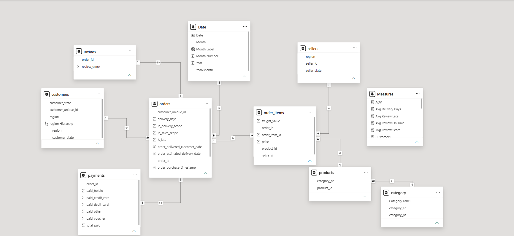
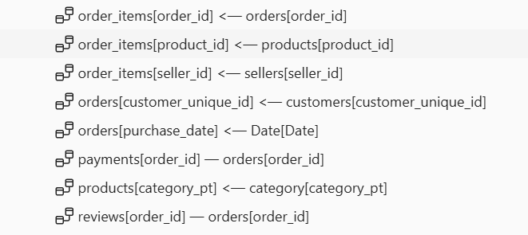
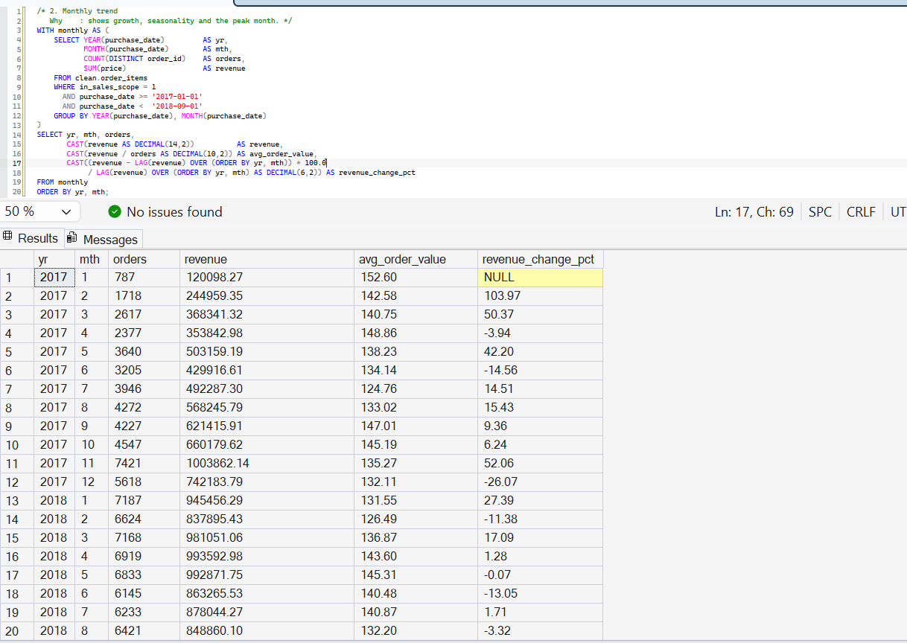
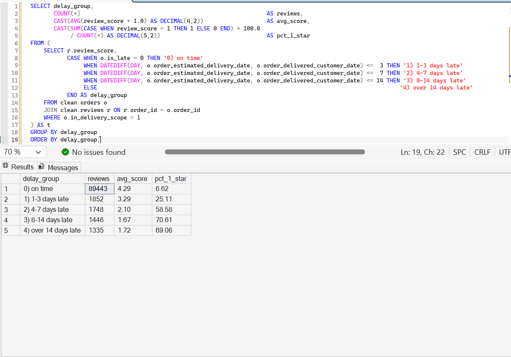
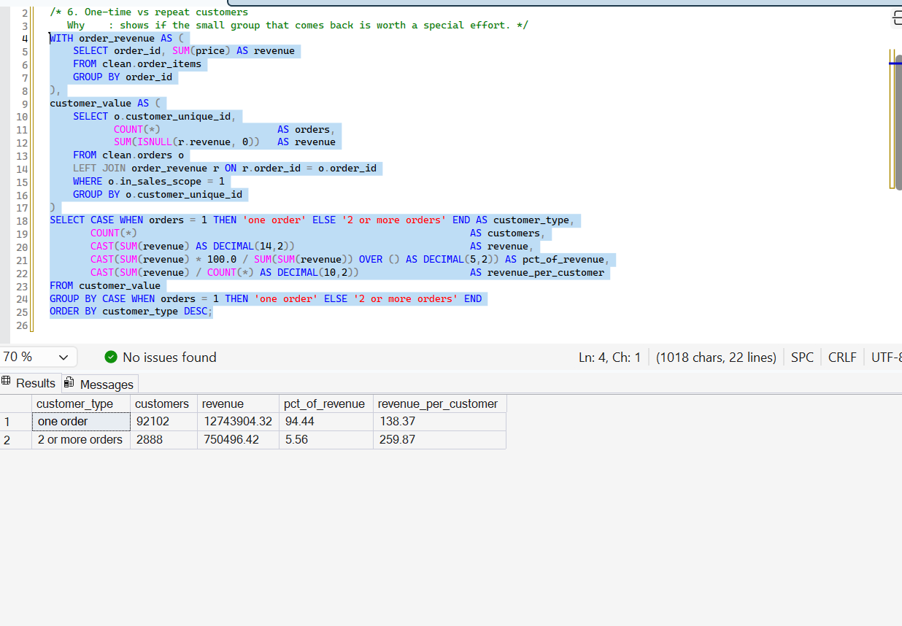
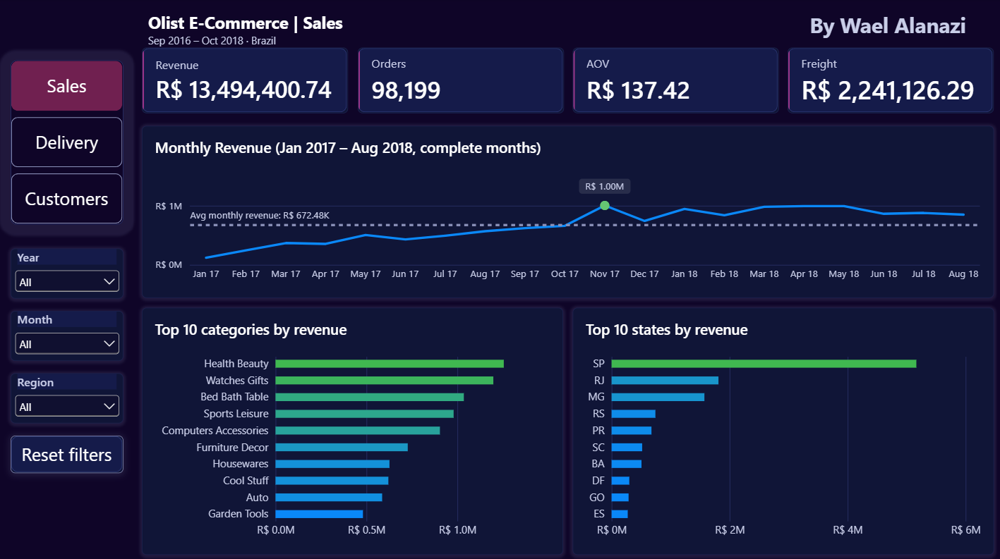
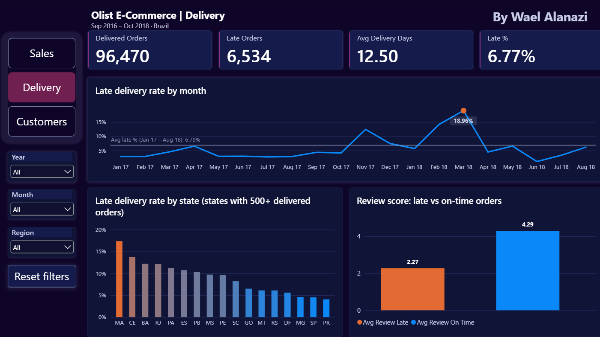
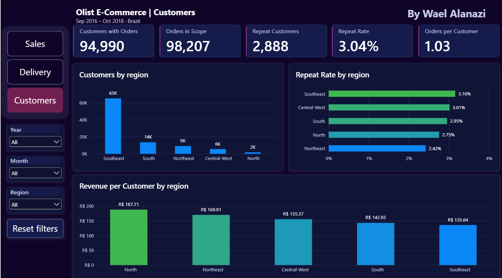

# Olist E-Commerce Analytics | SQL Server & Power BI

[Project Overview](#project-overview) · [Business Problem](#business-problem) · [Key Insights](#key-insights) · [SQL and Data Modeling](#sql-and-data-modeling) · [Power BI Dashboard](#power-bi-dashboard) · [Data Validation](#data-validation) · [Repository Guide](#repository-guide)

## Project Overview

I took the public Olist dataset, about 100K orders from a Brazilian online marketplace between 2016 and 2018, and worked on it from start to finish. I loaded the 9 CSV files into SQL Server, checked every table, cleaned them in SQL views, answered three business questions with queries, and built a three-page Power BI dashboard on top. At the end I checked that SQL and Power BI give the same numbers.


The dashboard is the file `project_olist.pbix` (open it with the free Power BI Desktop). All three pages are shown in the Power BI Dashboard section below.

**In numbers:** 98,199 orders and R$ 13.49M of revenue in the sales scope, 96,470 delivered orders, 96,096 real customers, and 15 dashboard numbers checked against SQL (all match). All amounts are in Brazilian reais (R$).

**Tools and skills:** SQL Server and SSMS (T-SQL, CTEs, window functions, views), Power BI (Power Query, DAX), dimensional data modeling, data validation.

## Business Problem

Olist connects small sellers to customers across Brazil. A marketplace like this grows only if it sells more, delivers on time, and keeps its customers. I turned that into three questions:

| Question | Why it matters | Answered in |
|---|---|---|
| How much do we sell, when, and what? | Shows where the money comes from and how dependent it is on a few categories, sellers and states | `10_sales_analysis.sql`, Sales page |
| How often are orders late, and does lateness hurt the reviews? | Late deliveries are a cost the marketplace pays in bad reviews | `11_delivery_satisfaction_analysis.sql`, Delivery page |
| Who are the customers, and do they come back? | Growth that depends only on new customers is expensive | `12_customer_analysis.sql`, Customers page |

## Key Insights

**1. Growth came from more orders, not bigger ones.** Revenue went from 120K in January 2017 to 1.00M in November 2017 (most likely Black Friday, which the data suggests but cannot prove), then stayed between 0.84M and 0.99M a month through 2018. Over the same 20 complete months the monthly orders went from 787 to 7,421 at the peak, while the average order value, calculated the same way every month, stayed between 125 and 153. So the marketplace grew by adding orders, and that growth stopped after the 2017 peak. The next question is where new customers stopped coming from.

**2. Revenue depends on a few categories, sellers and states.** 18 of the 74 categories make 80% of the revenue, the top 10% of sellers (306) make 67.5%, and SP, RJ and MG bring 63%. Losing a few big sellers or one category would be felt immediately, so that is where the attention should go.

**3. Late deliveries are a local problem, not a general one.** 6.77% of the orders are late, but the late rate was about 3% for most of 2017 and then 14% in February 2018 and 19% in March 2018. By state it ranges from 4.5% in SP to 17% in MA, and RJ (12%) is much worse than its neighbor MG (4.6%), so distance alone does not explain it. The data does not show the cause; the months and states above are where I would start looking.

**4. A late delivery costs a review point very fast.** Late orders score 2.27 against 4.29 for on-time orders, and 54% of them give 1 star against 7%. Being only 1 to 3 days late already drops the score to 3.29, and after a week it is about 1.7 and stays there. The first days of delay do most of the damage.

**5. Customers rarely come back.** The repeat rate is 3.04%, and 94% of the revenue comes from customers who bought once. A repeat customer is worth 1.9 times a one-time customer, and half of the repeat customers return within 30 days, so that first month is where a reminder or an offer would make sense. Customers whose first delivery was late came back 36% less often (2.76% against 4.30%). That group is small (64 customers who came back), so I read it as a signal and not as proof.

**6. The far regions are valuable but expensive to serve.** Customers in the North spend 187.71 each against 135.64 in the Southeast, but freight is 22.7% of the price there against 15.2%, and the region has only 2.5% of the revenue. The data cannot prove that freight keeps customers away, but it is a reasonable thing to test.

**What the data cannot say:** it is observational, so a late order that scores low does not prove lateness is the only cause. There is no cost or profit, so this is about revenue and not margin. The data ends on 2018-10-17, and 2016 and the last two months are incomplete.

## SQL and Data Modeling

The work follows five steps. The raw tables are never changed and nothing is deleted: filters are applied per question.

| Step | What happens | Where |
|---|---|---|
| Load | The 9 CSV files become 9 raw tables in schema `olist` | `sql/00_load_data.sql` |
| Explore | Every table is checked: keys, missing values, ranges, joins | `sql/01` to `sql/08` |
| Clean | One clean view per table, every fix written once | `sql/09_clean_views.sql` |
| Analyze | Sales, delivery and satisfaction, customers | `sql/10` to `sql/12` |
| Reconcile | SQL numbers compared with Power BI numbers | `sql/13` |

| Table | Rows | One row is |
|---|---|---|
| `customers` | 99,441 | one customer per order (`customer_id`) |
| `orders` | 99,441 | one order |
| `order_items` | 112,650 | one item of an order |
| `order_payments` | 103,886 | one payment of an order |
| `order_reviews` | 99,224 | one review |
| `products` | 32,951 | one product |
| `sellers` | 3,095 | one seller |
| `product_category_translation` | 71 | one category name |
| `geolocation` | 1,000,163 | one coordinate of a zip prefix (not used, see below) |

### Exploration (files 01 to 08)

I went through the tables one by one. In every file each section says why the check is run and, when a rule comes out of it, what I decided. The results are here. For each table I looked at the primary key and duplicates, missing values, value ranges, and whether it joins cleanly to the others.

| What I found | File | What I did about it |
|---|---|---|
| `customer_id` is created per order, so one person has several | 01 | count customers by `customer_unique_id` (96,096 real customers over 99,441 orders) |
| Canceled or unavailable orders are not sales | 02 | the sales scope leaves them out |
| 8 delivered orders have no delivery date | 02 | delivery scope = delivered with a delivery date (96,470 orders) |
| 165 orders have a carrier date before the purchase; 23 have delivery before carrier | 02 | kept and flagged (`stage_dates_ok`) |
| An order has several items; the key of items is `order_id` + `order_item_id` | 03 | revenue = `SUM(price)`, freight kept separate |
| 2,961 orders were paid in several payments | 04 | payments added up per order |
| `review_id` is not unique; 547 orders have more than one review; 768 have none | 05 | keep the latest review per order |
| 610 products have no category; 6 have weight 0 or missing | 06 | label `unknown`; flag the weight |
| Seller city is typed by hand (typos, e-mails, zip codes); state is clean | 07 | sellers are analyzed by state |
| 5 English category names are misspelled; 2 categories have no translation | 08 | corrected or named by hand |
| Geolocation: 26% exact copies, points outside Brazil | 08 | table left out; the analysis works at state level |

<details>
<summary>Key numbers per table (click to open)</summary>

**01 customers** (99,441 rows)
- 99,441 distinct `customer_id` but 96,096 real customers; 0 NULLs; 27 states and 4,119 cities.
- SP 41.94%, RJ 12.89%, MG 11.72% of the customers.
- 93,099 customers bought once and 2,997 bought two or more times: repeat rate 3.12% on all orders (3.04% in the sales scope, file 12).

**02 orders** (99,441 rows)
- Status: delivered 96,478 (97%), shipped 1,107, canceled 625, unavailable 609, invoiced 314, processing 301, created 5, approved 2.
- Purchases run from 2016-09-04 to 2018-10-17; 2016 has 329 orders and no November, and 2018-09 and 2018-10 hold only 20.
- 96,470 delivered orders have a delivery date: 0 to 210 days, average 12.50; 6,534 are late (6.77%); 298 (0.31%) took more than 60 days.

**03 order_items** (112,650 rows, 98,666 orders)
- 90.06% of the orders have one item; average 1.14 items per order; maximum 21.
- Price 0.85 to 6,735.00 (average 120.65); freight 0.00 to 409.68 (average 19.99), 16.57% of the price; 383 free-shipping rows.
- Before any status filter: price 13,591,643.70 and freight 2,251,909.54.
- 5.78% of 96,311 checked orders reached the carrier after the seller's deadline.

**04 order_payments** (103,886 rows, 99,440 orders)
- By value: credit card 78.3%, boleto 17.9%, voucher 2.4%, debit card 1.4%.
- 96,479 orders (97.02%) have one payment; installments average 2.85.
- Payments total 16,008,872.12 against 15,843,553.24 for items (price + freight); 99.75% of the orders match within 1.00, and most of the gap sits in the 775 orders without items.
- 1 delivered order has no payment.

**05 order_reviews** (99,224 rows, 98,673 orders)
- Score: 5 stars 57.78%, 1 star 11.51%; average 4.09.
- 768 orders have no review (646 of them delivered).
- 41.25% of the reviews have a message: 76.53% of the 1-star reviews against 35.80% of the 5-star reviews.
- 64 reviews are dated before the purchase day.

**06 products** (32,951 rows)
- 610 products have no category (and no name length, description length or photos); 73 categories; the top 15 hold 75.9% of the products.
- 4 products have weight 0 and 2 have no weight.
- 2 categories have no translation: `pc_gamer` (3 products) and `portateis_cozinha_e_preparadores_de_alimentos` (10).

**07 sellers** (3,095 rows)
- 23 states: SP holds 59.74% of the sellers, PR 11.28%, MG 7.88%; 4 customer states have no seller (AL, TO, RR, AP).
- 3,053 sellers have sales in the sales scope; the top seller makes 1.70% of the revenue.

**08 product_category_translation** (71 rows)
- 71 Portuguese names map to 71 English names; no NULLs, no extra spaces.
- 5 English names are misspelled: `fashio_female_clothing`, `costruction_tools_garden`, `costruction_tools_tools`, `home_confort`, `arts_and_craftmanship`.

</details>

### Cleaning (file 09)

The cleaning layer is one view per raw table, in schema `clean`. A view stores no data, it is a saved query, so the raw tables stay untouched and every rule lives in one place. The analysis files and Power BI read only from `clean`. Each view has a validation query with its expected result, written next to it.

| View | One row is | Cleaning | Added columns | Rows |
|---|---|---|---|---|
| `clean.category` | one product category | 5 spelling errors corrected; 2 untranslated categories named by hand | row `unknown` | 71 → 74 |
| `clean.product` | one product | no category becomes `unknown` | `has_valid_weight`, English category name | 32,951 |
| `clean.customer` | one real customer | latest city and state per `customer_unique_id` | `region` | 99,441 orders → 96,096 customers |
| `clean.seller` | one seller | city dropped | `region` | 3,095 |
| `clean.orders` | one order | `customer_unique_id` added; out-of-sequence dates kept | `in_sales_scope`, `in_delivery_scope`, `delivery_days`, `is_late`, `stage_dates_ok` | 99,441 |
| `clean.order_items` | one item | none needed | purchase date and `in_sales_scope` from the order | 112,650 |
| `clean.payments` | one order | several payments added up | `total_paid`, amount by payment type | one per order |
| `clean.reviews` | one order | latest review kept | `has_comment` | 99,224 reviews → 98,673 orders |

`order_items` to `orders`, `product` and `seller`, `orders` to `customer`, and `product` to `category` are many to one. `payments` and `reviews` to `orders` are one to one. Power BI uses the same relationships on the same columns.

### The data model

The model in Power BI is not a pure star schema. It is a snowflake-style model with several fact tables (close to a galaxy schema), and `orders` is the table in the middle. `order_items` is the main fact table: one row is one item sold, so revenue and freight are summed there. `payments` (amounts paid) and `reviews` (scores) are two more fact tables, kept at order level, one row per order, so they join to `orders` one to one and never repeat an order. `products` and `sellers` connect to `order_items`. `customers` and the `Date` table connect through `orders`, and `category` connects through `products`, so some dimensions sit one step further out. `orders` is also more than a dimension, because it holds the order-level facts the delivery analysis needs (status, dates, the scope and late flags).





### Decisions that shape the numbers

A few choices changed the results, so I made them once, in the SQL views, and used them everywhere:

- **A customer is `customer_unique_id`, not `customer_id`.** The `customer_id` changes with every order. Counting it gives 99,441 customers instead of 96,096 and a wrong repeat rate.
- **An order is `COUNT(DISTINCT order_id)`.** Never rows of items, payments or reviews. Joining payments or reviews to items repeats each order once per item and inflates the sums, so they join to orders only.
- **Sales scope:** every order except `canceled` and `unavailable`. Revenue is `SUM(price)` and freight is a separate measure. (467 canceled or unavailable orders still have items, 97,242.96 in total, so a plain sum of prices would be wrong.)
- **Delivery scope:** `delivered` with a delivery date, 96,470 orders.
- **A late order** has a delivery date after the estimated date, compared by date and not by time. The estimated dates always have time 00:00:00, so comparing times would change the late rate.
- **One review per order:** the latest one (547 orders have more than one).
- **Trend period:** 2017-01 to 2018-08. 2016 and the last two months are incomplete, so they stay out of the trend charts but are kept in the totals.

### Analysis queries and results (files 10 to 12)

#### Sales (file 10)
| Area | Result |
|---|---|
| Size | 98,199 orders, 94,983 customers, revenue 13,494,400.74, freight 2,241,126.29, average order value 137.42 |
| Trend | from 120K (2017-01) to a peak of 1.00M (2017-11, 7,421 orders), then flat in 2018 between 0.84M and 0.99M |
| Categories | the top 10 hold 62.37% of the revenue; 18 of 74 make 80%; `bed_bath_table` has the most orders and `health_beauty` the most revenue |
| Geography | SP, RJ and MG bring 63.36%, the Southeast 65.39%; the North has the highest order value (181.98) and the lowest share (2.47%) |
| Freight | 22.74% of the price in the North and 21.74% in the Northeast, against 15.16% in the Southeast |
| Sellers | the top 10% (306) make 67.50% of the revenue; the bottom half makes 3.24% |
| Payments | 78.47% of the amount paid is by credit card, 17.96% boleto, 2.22% voucher, 1.35% debit card |



#### Delivery and satisfaction (file 11)
| Area | Result |
|---|---|
| Delivery time | 96,470 delivered orders; average 12.5 days, median 10; 71% arrive within 14 days |
| Late orders | 6,534 (6.77%); 44% of them are more than a week late |
| Over time | 12.40% in 2017-11, 14.13% in 2018-02 and 18.96% in 2018-03; it falls from 2018-04 |
| By state | highest in MA (17.36%), CE, BA, RJ (12.11%) and PA; SP is the fastest (8.7 days, 4.49% late) |
| Reviews | 99.33% of delivered orders have a review; average 4.16; 59.21% give 5 stars and 9.76% give 1 star |
| Late vs on time | 2.27 against 4.29; 53.78% of the late orders give 1 star against 6.62%; late orders are 6.7% of the reviews but about 37% of the 1-star reviews |
| By delay | the score drops from 4.29 to 3.29 after 1 to 3 days late and to about 1.7 after a week; longer delays do not lower it further |



#### Customers (file 12)
| Area | Result |
|---|---|
| Customers | 94,990 customers placed an order (96,096 in total); 1.03 orders per customer |
| Repeat rate | 96.96% buy once, 3.04% come back; 30% of the repeat customers order again on the same day, so only 2.13% of all customers return on a later day |
| Time to return | half of the repeat customers (50.87%) buy again within 30 days |
| Geography | the repeat rate is about the same everywhere (2.4% to 3.4%); the Southeast has 68.49% of the customers |
| Value | the farther the region, the more each customer spends (North 187.71, Northeast 169.91, SP 129.99) |
| Repeat vs one-time | a repeat customer is worth 1.9 times a one-time customer (259.87 against 138.37), but repeat customers bring only 5.56% of the revenue |
| After a late delivery | customers whose first order was late come back less: 2.76% against 4.30% (customers whose first order was before 2018) |



## Power BI Dashboard

The dashboard has three pages, one per business question. Power BI loads the eight clean views in Import mode and uses the relationships above.

### Sales


Revenue, orders, average order value and freight, the monthly revenue trend (with the peak month marked and the monthly average as a reference line), the top 10 categories and the top 10 states.

### Delivery and satisfaction


Delivered orders, late orders, average delivery days and late %, the late rate by month, the late rate by state (states with 500 or more delivered orders), and the review score of late against on-time orders.

### Customers


Customers with orders, repeat customers and repeat rate, customers by region, the repeat rate by region and the revenue per customer by region.

### How it works

There is a page navigator, dropdown slicers (year, month, region) that stay in sync across the pages, and a reset button. Hovering a bar or a point opens a tooltip page with the details of that item. Colors have a fixed meaning: blue is neutral, green is good or top, orange is bad or at risk, grey is a reference line. All amounts are shown in R$.

### Power BI preparation

Power BI loads the eight clean views in Import mode. In Power Query I only removed columns the dashboard does not need, and added one display column, `Category Label` (underscores replaced by spaces, each word capitalized; the original `category_en` stays for joins). No values are changed and no rows are filtered, so Power BI starts from the same data as the SQL.

| Table | Columns removed |
|---|---|
| `product` | `photos_qty`, `weight_g`, `length_cm`, `height_cm`, `width_cm`, `has_valid_weight` |
| `orders` | `customer_id`, `order_approved_at`, `order_delivered_carrier_date`, `stage_dates_ok` |
| `order_items` | `shipping_limit_date`, `purchase_date`, `in_sales_scope` (both come from `orders` through the relationship) |
| `reviews` | `review_id`, `review_creation_date`, `review_answer_timestamp`, `has_comment` |
| `payments` | `payments` (number of payments) |
| `customer` | `customer_city` |

Problems I ran into while building the model:

| Problem | Numbers | What I did |
|---|---|---|
| Canceled and unavailable orders still have items | 467 orders, 549 item rows, 97,242.96 | every sales measure filters `orders[in_sales_scope] = 1`, so revenue is 13,494,400.74 and not 13,591,643.70 |
| Orders in the sales scope without items | 8 orders (5 created, 2 invoiced, 1 shipped) | the Orders measure counts `order_id` through `order_items`: 98,199 instead of 98,207 |
| Customers whose only orders have no items | 7 customers | the Customers measure counts only customers of orders with items: 94,983 |
| Missing delivery fields | orders outside the delivery scope | left blank, never replaced with 0; delivery measures filter `in_delivery_scope = 1` |
| The same column in two tables | `purchase_date`, `in_sales_scope` | kept in `orders` only; `order_items` gets them through the relationship |

The measures that apply the sales scope:

```
Orders    = CALCULATE(DISTINCTCOUNT(order_items[order_id]), orders[in_sales_scope] = 1)
Revenue   = CALCULATE(SUM(order_items[price]), orders[in_sales_scope] = 1)
Freight   = CALCULATE(SUM(order_items[freight_value]), orders[in_sales_scope] = 1)
AOV       = DIVIDE([Revenue], [Orders])
Customers = CALCULATE(DISTINCTCOUNT(orders[customer_unique_id]),
                      orders[in_sales_scope] = 1,
                      TREATAS(VALUES(order_items[order_id]), orders[order_id]))
```

The two review measures behind the late and on-time cards:

```
Avg Review Late    = CALCULATE(AVERAGE(reviews[review_score]), orders[in_delivery_scope] = 1, orders[is_late] = 1)
Avg Review On Time = CALCULATE(AVERAGE(reviews[review_score]), orders[in_delivery_scope] = 1, orders[is_late] = 0)
```

## Data Validation

I ran the same measure in SQL (file 13) and read it from the Power BI cards, with all slicers cleared:

| Page | Measure | SQL | Power BI |
|---|---|---|---|
| Sales | Orders | 98,199 | 98,199 |
| Sales | Customers (orders with items) | 94,983 | 94,983 |
| Sales | Revenue | 13,494,400.74 | 13,494,400.74 |
| Sales | Freight | 2,241,126.29 | 2,241,126.29 |
| Sales | Average order value | 137.42 | 137.42 |
| Delivery | Delivered orders | 96,470 | 96,470 |
| Delivery | Late orders | 6,534 | 6,534 |
| Delivery | Late % | 6.77% | 6.77% |
| Delivery | Average delivery days | 12.50 | 12.50 |
| Delivery | Average review score, on time | 4.29 | 4.29 |
| Delivery | Average review score, late | 2.27 | 2.27 |
| Customers | Customers with orders | 94,990 | 94,990 |
| Customers | Orders in scope | 98,207 | 98,207 |
| Customers | Repeat customers | 2,888 | 2,888 |
| Customers | Repeat rate | 3.04% | 3.04% |

All 15 match. One of them did not at first: Power BI showed 2.30 for late orders instead of 2.27. I compared the DAX with the SQL and the logic was identical, so the measure was not the problem. It was a filter I had left on the Delivery page. After I removed it, both gave 2.27.

Two numbers look different but are not a mistake: the Sales page counts 98,199 orders and the Customers page 98,207. The Sales page counts orders that have at least one item, because an order without items has no revenue. The Customers page counts every order in the sales scope, because a customer who placed an order is a customer even if the order has no items yet. The difference is 8 orders and 7 customers (below 0.01%), all still `created`, `invoiced` or `shipped`. I kept both definitions on purpose.

Other checks along the way: every clean view has a validation query with its expected result (`09_clean_views.sql`), the load is checked against the expected row count of each table (`00_load_data.sql`), and the payments were compared with the items to confirm that revenue does not depend on which table it is taken from.

## Repository Guide

### How to run it yourself

1. Download the dataset from Kaggle: [Brazilian E-Commerce Public Dataset by Olist](https://www.kaggle.com/datasets/olistbr/brazilian-ecommerce). The CSV files are not in this repository.
2. In SQL Server (2017 or later), create the database `OlistDB` and the schema `olist`.
3. Copy the 9 CSV files to a folder the SQL Server service can read (for example `C:\OlistData\`) and set that path in `sql/00_load_data.sql`.
4. Open the files in `sql/` in SSMS and run them in order. `00_load_data.sql` creates the raw tables and loads the CSV files; `09_clean_views.sql` creates the schema `clean` and the views.
5. Open `project_olist.pbix` in Power BI Desktop and point the data source to your SQL Server.

```
Olist/
  README.md
  project_olist.pbix                       Power BI dashboard
  images/                                  screenshots
  sql/
    00_load_data.sql
    01_customers_exploration.sql ... 08_category_translation_exploration.sql
    09_clean_views.sql
    10_sales_analysis.sql
    11_delivery_satisfaction_analysis.sql
    12_customer_analysis.sql
    13_reconciliation_sql_vs_powerbi.sql
```

<details>
<summary>Data quality notes (excluded only from the affected metrics, never deleted)</summary>

- 8 delivered orders without a delivery date.
- 165 orders with carrier date before purchase; 23 with delivery before carrier.
- 775 orders without items: 767 canceled or unavailable and 8 in the sales scope (5 created, 2 invoiced, 1 shipped); 1 delivered order without payment.
- 467 canceled or unavailable orders do have items (549 item rows, price 97,242.96). They stay in the tables and are left out of the sales measures through `in_sales_scope`.
- 547 orders have more than one review (the latest is used); 768 orders have no review; 64 reviews are dated before the purchase day.
- 610 products without a category (kept as `unknown`); 6 products with weight 0 or missing.
- Geolocation (1,000,163 rows for 19,015 zip prefixes) is left out: 26% exact copies, points outside Brazil and wrong points inside Brazil. The table stays in the database untouched.
- Seller city is not used (inconsistent text); sellers are analyzed by state.
- The data ends on 2018-10-17; 2016 and 2018-09/10 are incomplete and stay out of trend charts.

</details>

<details>
<summary>Glossary</summary>

| Term | Meaning here |
|---|---|
| Raw data | Data exactly as loaded from the CSV files (schema `olist`) |
| View | A saved query with a name; it stores no data |
| Grain | What one row means ("one order", "one item") |
| Scope / flag | A 0/1 column that marks which rows count for a metric |
| Fact / Dimension | Fact = events with numbers (items, orders); dimension = description (customer, product, seller) |
| Reconciliation | Checking that SQL and Power BI give the same numbers |
| AOV | Average order value = revenue / number of orders |

</details>

## About the data

The Olist dataset is real, anonymized data published on Kaggle by Olist under the CC BY-NC-SA 4.0 license, so the original CSV files are not copied here. The `.pbix` file does hold a processed copy of the data (Import mode); it is shared under the same license: credit to Olist, non-commercial use only. Per the dataset description, company and partner names in the review texts are replaced by Game of Thrones house names.

## Author

Wael Alanazi · [GitHub](https://github.com/wael-alanazi)
<!-- Add the LinkedIn link next to GitHub, then delete this line. -->
